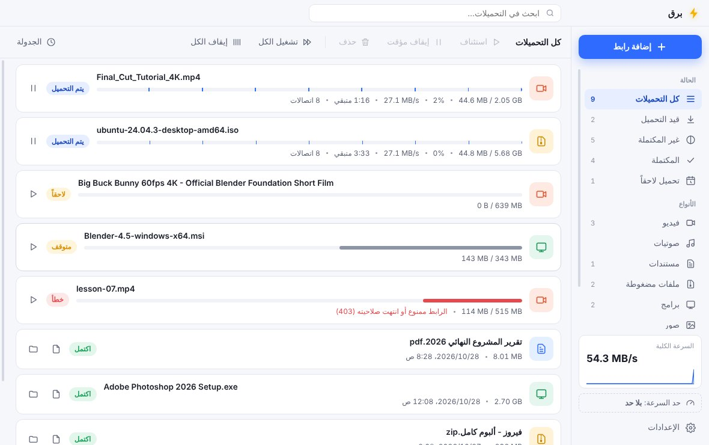

<p align="center"></p>
<h1 align="center">برق — Barq Download Manager</h1>
<p align="center"><b><a href="https://dlwjan11-dot.github.io/barq/">الموقع والتنزيل · Website &amp; download</a></b> · <a href="https://github.com/dlwjan11-dot/barq/releases/latest">آخر نسخة · Latest release</a></p>
<p align="center"></p>

A free, open-source download manager for **Windows and macOS**, in Arabic and English: up to 32 connections per file with smart splitting, resume, YouTube and video sites (yt-dlp), torrents and magnet links (aria2), scheduler, speed limits, and browser extensions for Firefox, Chrome and Edge.


مدير تحميل سريع لـ Windows، متل Internet Download Manager: تحميل على عدة اتصالات، استكمال، فيديو يوتيوب والمواقع، تورنت، وإضافة للمتصفح. الواجهة عربي وإنجليزي.

## التشغيل
- **Barq-Setup-1.0.0.exe**: برنامج التنصيب. البرنامج غير موقّع لهلق، فـ Windows ممكن يعرض تحذير "SmartScreen": اضغط **More info ← Run anyway**.
- **Barq-1.0.0-portable.zip**: نسخة بدون تنصيب. فكّ الضغط وشغّل `Barq.exe`.

## الميزات
**التحميل**
- تقسيم ذكي على 1–32 اتصال. الاتصال يلي بيخلص بياخد نص أكبر جزء باقي، فكل الاتصالات بتضل شغالة للآخر.
- الأجزاء بتنكتب مباشرة بملف واحد، بدون مرحلة دمج بالآخر.
- استكمال بعد الإيقاف أو انقطاع النت أو إغلاق البرنامج. إذا تغيّر الملف على السيرفر بيبدأ من جديد وبيخبرك.
- إعادة محاولة تلقائية للاتصالات المقطوعة. أخطاء متل 404 و 403 بتوقف فوراً بدل ما تعيد للأبد.
- إذا السيرفر قال إنه مشغول (429/503) بيخفف عدد الاتصالات بشكل مؤقت.
- حد سرعة لكل التحميلات، أو لكل تحميل لحاله.
- صف انتظار: عدد التحميلات بنفس الوقت قابل للتعديل، ومع ترتيب الدور.
- جدولة: وقت بداية ووقت نهاية وأيام محددة. وبعد ما يخلص كل شي: إطفاء الجهاز، أو سكون، أو إغلاق البرنامج.
- تصنيفات تلقائية حسب النوع (فيديو، صوتيات، مستندات، مضغوطة، برامج، صور، تورنت)، ومجلد لكل نوع.
- فحص المساحة قبل التحميل، والاسم الحقيقي للملف (مع العربي)، وأسماء آمنة على Windows.
- منع تكرار نفس الرابط، وتحديث الرابط إذا انتهت صلاحيته مع الاحتفاظ بالجزء المحمّل.
- التحقق من الملف بـ SHA-256، ودعم البروكسي (HTTP و SOCKS5).
- الكمبيوتر ما بيدخل وضع السكون وفي تحميل شغال.

**الفيديو**: يوتيوب، فيميو، تيك توك، تويتر/X، فيسبوك، إنستغرام وغيرهم كتير.
- اختيار الجودة مع الحجم.
- صوت فقط بصيغة M4A أو MP3.
- قوائم تشغيل وقنوات كاملة.
- ترجمة مدمجة بالفيديو.
- روابط بث m3u8.

**التورنت**: روابط magnet وملفات `.torrent`.
- اختيار الملفات قبل البدء.
- نسبة مشاركة وحد سرعة رفع.
- عرض الأجهزة المتصلة وتقدّم كل ملف.
- بيشتغل كمان مع روابط FTP.

**المتصفح** (Chrome و Edge و Brave و Opera):
- بيلتقط التحميلات تلقائياً حسب نوع الملف.
- زر "تحميل بـ برق" فوق أي فيديو.
- قائمة الزر اليمين: تحميل رابط، أو كل الروابط المحددة، أو فيديو الصفحة.
- كشف ملفات الفيديو والبث بالصفحة.
- بيبعت تسجيل الدخول (الكوكيز) مع التحميل.

**عام**:
- مراقبة الروابط المنسوخة.
- أيقونة بجانب الساعة.
- إشعارات عند انتهاء التحميل.
- سحب وإفلات ملفات التورنت.
- وضع فاتح وداكن.
- اختصارات: `Ctrl+V` للصق، `Ctrl+N` لرابط جديد، `Space` للإيقاف أو الاستئناف، `Delete` للحذف.

## تركيب إضافة المتصفح
1. من البرنامج: **الإعدادات ← المتصفح ← افتح مجلد الإضافة**.
2. افتح `chrome://extensions` (أو `edge://extensions`) وفعّل **Developer mode**.
3. اسحب المجلد للصفحة (أو **Load unpacked**).
4. اضغط أيقونة برق بالمتصفح ← **ربط**، ووافق بنافذة برق.

## الماك (macOS 12 أو أحدث)
- **Barq-1.0.2-mac-arm64.zip**: لأجهزة Apple Silicon (M1 ،M2 ،M3 ،M4…).
- **Barq-1.0.2-mac-x64.zip**: لأجهزة Intel.
- لتعرف نوع جهازك:  ← About This Mac. إذا مكتوب "Chip: Apple M…" فهو Apple Silicon.
- فكّ الضغط واسحب Barq إلى Applications. البرنامج موقّع توقيع محلي بس، مو من Apple، فأول مرة:
  افتح Terminal واكتب `xattr -cr /Applications/Barq.app`، أو جرّب افتحه ثم من System Settings ← Privacy & Security اضغط **Open Anyway**.
- التورنت على Apple Silicon بيحتاج Rosetta (الماك بيعرض تنزيلها تلقائياً أول مرة).
- البناء من Linux: `npx electron-builder --mac` ثم `node scripts/sign-mac.js` (يحتاج rcodesign).

## فايرفوكس
- الملف `Barq-Firefox.xpi` (يتبنى بـ `scripts/build-firefox.sh`).
- تجربة مؤقتة: `about:debugging` ← This Firefox ← Load Temporary Add-on ← اختر الملف (تنمسح عند إغلاق فايرفوكس).
- تركيب دائم: ارفعه على addons.mozilla.org كـ "On your own" ليتوقّع مجاناً، بعدها اسحب الملف الموقّع لفايرفوكس.

## الأخطاء يلي انصلحت من المشاريع التلاتة
| المشكلة | بأي مشروع | الحل ببرق |
|---|---|---|
| تقسيم ثابت: الاتصال يلي بيخلص بيقعد فاضي | Awesome Downloader | تقسيم ذكي، الاتصال الفاضي بياخد نص أكبر جزء |
| فشل اتصال واحد بيلغي كل التحميل | Awesome Downloader | إعادة محاولة لكل اتصال لحاله |
| كل جزء بملف لحاله ودمج بطيء بالآخر | Awesome Downloader | كتابة مباشرة بملف واحد |
| يوتيوب بيعتمد على بروتوكول بينكسر | Awesome Downloader | yt-dlp مع زر تحديث |
| الإضافة بتتركب يدوياً بدون شرح | Awesome / Gunda | خطوات مشروحة داخل البرنامج، وربط بموافقة |
| ما في تقسيم أبداً (اتصال واحد) | Gunda | حتى 32 اتصال |
| ما في حد سرعة ولا جدولة ولا بروكسي | Gunda / DownloadCraft | كلها موجودة |
| ما في إضافة متصفح | DownloadCraft | موجودة |
| ما في دعم للعربي (RTL) | الكل | واجهة عربية كاملة من اليمين لليسار |

## للمطوّر
```
npm install
npm start                 # تشغيل
npm test                  # اختبارات المحرك
npm run dist              # بناء برنامج التنصيب (على Windows، أو Linux مع Wine)
```
- `src/core/`: المحرك.
  - `http-transfer.js`: التحميل على عدة اتصالات.
  - `manager.js`: الصف والجدولة.
  - `video.js`: الفيديو.
  - `aria2.js`: التورنت.
  - `tools.js`: الأدوات.
- `src/main/`: Electron.
  - `bridge.js`: الاتصال مع الإضافة.
- `src/renderer/`: الواجهة.
- `extension/`: إضافة المتصفح.

الأدوات المساعدة:
- **aria2** و **yt-dlp** مضمّنين بالبرنامج.
- **FFmpeg** و **Deno** بينزلوا من مصادرهم الرسمية أول مرة بتحتاجهم.
- كل أداة بتنفحص بـ SHA-256 قبل ما تنحفظ.
